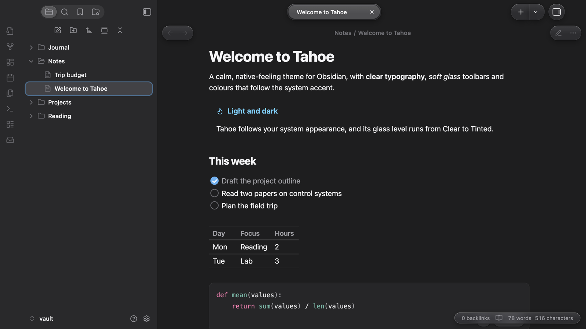

# Tahoe

A clean, Mac-like theme for Obsidian: edge-to-edge sidebars with coloured icons, glass toolbar capsules, a Spotlight-style command palette and settings laid out like the Mac's System Settings. In light and dark.

## Highlights

- **Edge-to-edge sidebars.** No floating card or shadow; the ribbon is part of the sidebar column.
- **Sidebar icons in colour.** Folders take the accent colour and open and close as you expand them. Notes, images, PDFs, canvases and bases each get their own icon and tint. The selection fills with the accent colour while the sidebar is the active pane, and turns grey when it isn't.
- **A glass toolbar.** Tabs sit in one capsule with the active tab raised. Back and forward, the sidebar toggles, new tab and the view actions are capsules too. When a note scrolls underneath, a frosted band fades in behind them, done in CSS with scroll-driven animation.
- **Glass from Clear to Tinted.** One level controls every glass surface: toolbar, menus, the command palette, notices and sheets.
- **Mac proportions.** Menu and window corners, spacing and control sizes are taken from macOS.
- **Inactive windows step back.** Toolbar controls and the title dim, and sidebar icons lose their colour.
- **System typography and colours.** The system font (SF Pro on a Mac), system label and accent colours, and Xcode-style code colours.
- **A Spotlight-style command palette** with a large search field.
- **Settings like System Settings.** A flush sidebar with coloured icon tiles, grouped cards for each section and capsule controls.
- **Controls.** Capsule buttons and pop-ups, switches, capsule sliders and round checklist boxes.
- **Phones and tablets.** A floating tab bar, capsule nav-bar buttons, floating sheets for menus and drawers, and grouped settings.

## Options

With the [Style Settings](https://github.com/mgmeyers/obsidian-style-settings) plugin you can:

- set the glass level, from Clear to Tinted;
- hide the frosted toolbar band;
- hide the sidebar file icons;
- strike through completed tasks.

## Tips

- **Turn off native menus** (Settings → Appearance) to get Tahoe's glass menus with icons. On macOS, native menus are drawn by the system, and no theme can change them.
- **Translucent window** (Settings → Appearance) lets the desktop show through the sidebars. It's supported, but less tested than the opaque look.

## Disclosures

Tahoe is a CSS theme. It loads nothing from the internet (no remote fonts or images) and collects nothing.

<!-- tahoe-family -->
## The Tahoe family

Tahoe is a set of plugins and a theme that work on their own and fit together.

| | | |
| --- | --- | --- |
| **[Tahoe Run](https://github.com/krishnanefx/obsidian-tahoe-run)** | Run the code in your notes, like a notebook: Python with a debugger and variables view, MATLAB, and ~25 other languages. | available |
| **[Tahoe Math](https://github.com/krishnanefx/obsidian-tahoe-math)** | A calculator in your notes: type an expression ending in `=` and the answer appears. | available |
| **Tahoe** | A clean, Mac-like theme, in light and dark. | this one |
| **[Tahoe Code](https://github.com/krishnanefx/obsidian-tahoe-code)** | An IDE in your code blocks: suggestions, checking as you type, quick fixes, go to definition, formatting and AI edits. | available |
| **Tahoe Glass** | Real refraction for the Tahoe theme's glass, and System Settings–style settings pages. | coming soon |
| **[Tahoe Organize](https://github.com/krishnanefx/obsidian-tahoe-organize)** | Keep a growing vault tidy: inbox triage, smart folders, colored tags, link suggestions, vault health, literature notes and text from images. | available |
| **Tahoe Intelligence** | On-device AI for your notes: ask your notes, related notes, distilling permanent notes and more. | coming soon |

**Better together**

- **With Tahoe Glass (coming soon):** the toolbar, menus and command palette get real refraction, with dispersion and glare, plus a pointer highlight; settings pages get System Settings–style header cards.
- **With [Tahoe Run](https://github.com/krishnanefx/obsidian-tahoe-run):** the Run capsules and output cards follow the theme's colours and controls.
- **With [Tahoe Code](https://github.com/krishnanefx/obsidian-tahoe-code):** suggestion lists, hover docs and problem cards in code blocks become solid cards with the theme's corners.
- **With [Tahoe Math](https://github.com/krishnanefx/obsidian-tahoe-math):** answers appear in the theme's accent colour.
- **With [Tahoe Organize](https://github.com/krishnanefx/obsidian-tahoe-organize):** Vault health, iCloud conflicts and inbox triage use the theme's settings-style cards.
<!-- /tahoe-family -->

## Credits

Tahoe builds on [Cupertino](https://github.com/svnaxis/obsidian-cupertino) by Alexis C, under the MIT License; its notice is in [THIRD_PARTY_NOTICES.md](THIRD_PARTY_NOTICES.md).

Tahoe is an independent project. It isn't affiliated with, or endorsed by, Apple.

## License

[MIT](LICENSE) © 2026 Krishnan Adaikkappan
