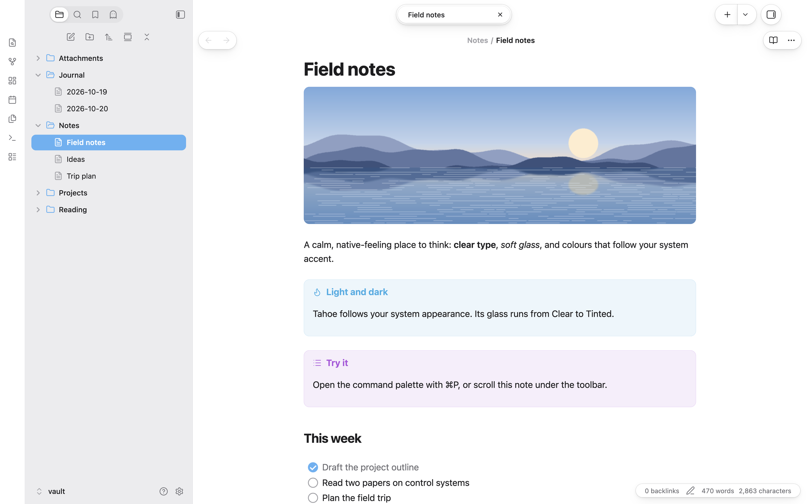
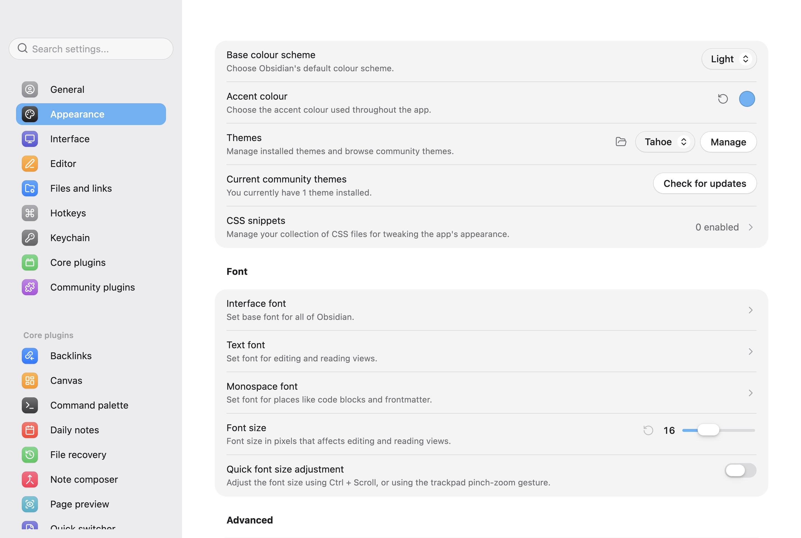
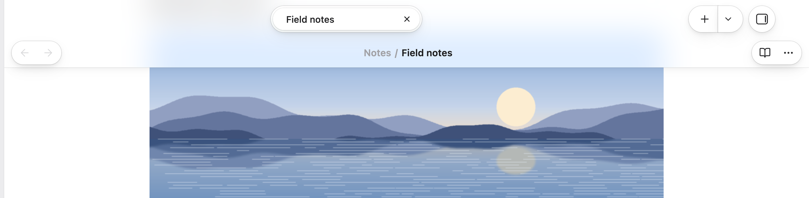
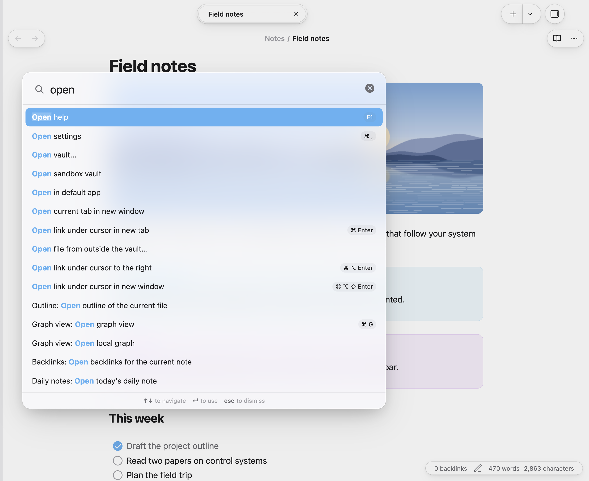
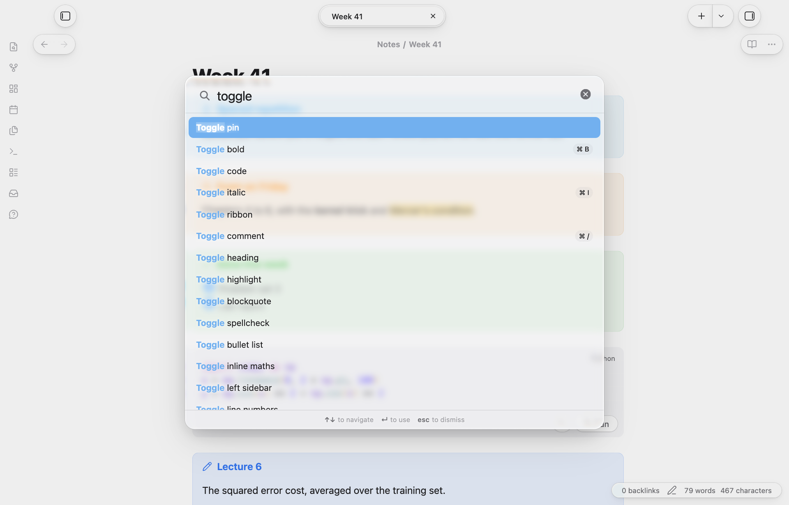
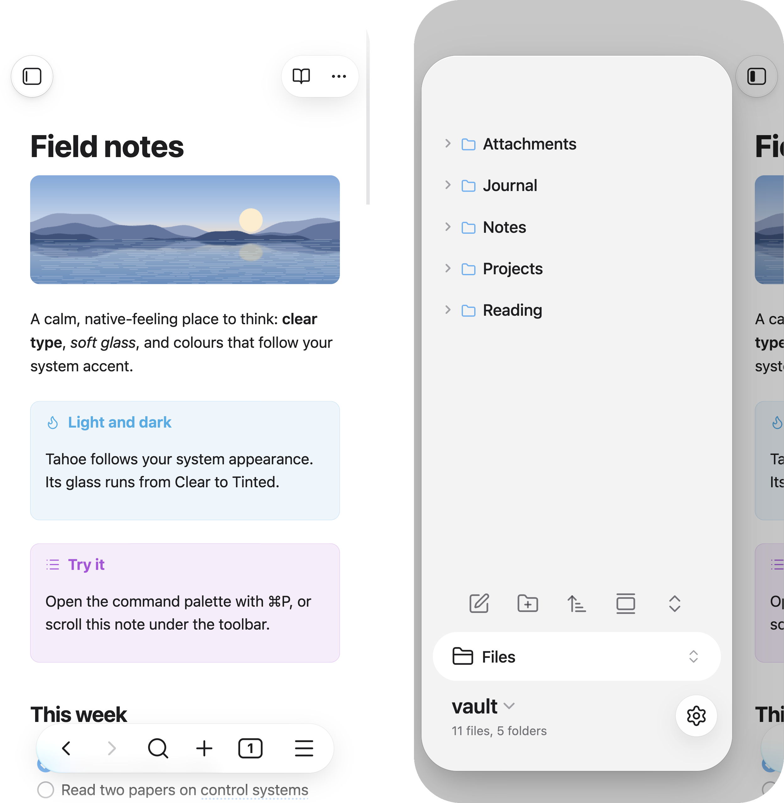

# Tahoe

**Obsidian, at home on your Mac.**

<picture>
  <source media="(prefers-color-scheme: dark)" srcset="images/dark.png">
  
</picture>

## The look

**Like the other apps on your Mac.** The system font, the system's label and accent colours, and the corners, spacing and control sizes of macOS. Sidebars run edge to edge, with coloured icons for folders, notes, images, PDFs, canvases and bases. In light and dark.

**Settings like System Settings,** with coloured icon tiles and grouped cards. Buttons and pop-ups are capsules, checklist boxes are round, and windows you aren't using step back: their controls dim and the sidebar icons lose their colour.

## The glass

**A glass toolbar.** Tabs sit in one capsule, with the active tab raised, and the other controls are capsules too. When a note scrolls under them, a frosted band fades in behind.

**One glass, from Clear to Tinted.** The toolbar, menus, the command palette, notices and sheets share one glass level, which you can set with Style Settings. The command palette is Spotlight-style, with a large search field.

**Real refraction, with [Tahoe Glass](https://github.com/krishnanefx/obsidian-tahoe-glass).** The optional plugin makes the glass bend what's behind it, with colour dispersion, glare and a highlight that follows the pointer. macOS.

## On iPhone and iPad

**Made for touch, too.** A floating tab bar, capsule buttons in the nav bar, floating sheets for menus and drawers, and grouped settings.

## What it's for

Tahoe is for people who'd like Obsidian to feel like a Mac app without setting anything up. Install it and that's the look: there are four options, and you don't need any of them.

## Pairs with

- **[Style Settings](https://github.com/mgmeyers/obsidian-style-settings):** set the glass level from Clear to Tinted, hide the frosted toolbar band, hide the sidebar file icons, and strike through completed tasks.
- **[Tahoe Glass](https://github.com/krishnanefx/obsidian-tahoe-glass):** real refraction for the glass, and header cards on settings pages.

## Tips

- **Turn off native menus** (Settings → Appearance) to get Tahoe's glass menus with icons. On macOS, native menus are drawn by the system, and no theme can change them.
- **Translucent window** (Settings → Appearance) lets the desktop show through the sidebars. It's supported, but less tested than the opaque look.

## Disclosures

Tahoe is a CSS theme. It loads nothing from the internet (no remote fonts or images) and collects nothing.

<!-- tahoe-family -->
## The Tahoe family

Tahoe is a set of plugins and a theme that work on their own and fit together.

| | | |
| --- | --- | --- |
| **[Tahoe Run](https://github.com/krishnanefx/obsidian-tahoe-run)** | Run the code in your notes, like a notebook: Python with a debugger and variables view, MATLAB, and ~25 other languages. | available |
| **[Tahoe Math](https://github.com/krishnanefx/obsidian-tahoe-math)** | A calculator in your notes: type an expression ending in `=` and the answer appears. | available |
| **Tahoe** | A clean, Mac-like theme, in light and dark. | this one |
| **[Tahoe Code](https://github.com/krishnanefx/obsidian-tahoe-code)** | An IDE in your code blocks: suggestions, checking as you type, quick fixes, go to definition, formatting and AI edits. | available |
| **[Tahoe Glass](https://github.com/krishnanefx/obsidian-tahoe-glass)** | Real refraction for the Tahoe theme's glass, and header cards on settings pages. | available |
| **[Tahoe Organize](https://github.com/krishnanefx/obsidian-tahoe-organize)** | Keep a growing vault tidy: inbox triage, smart folders, colored tags, link suggestions, vault health, literature notes and text from images. | available |
| **[Tahoe Intelligence](https://github.com/krishnanefx/obsidian-tahoe-intelligence)** | On-device AI for your notes: ask your notes, related notes, distilling permanent notes and more. | available |

**Better together**

- **With [Tahoe Glass](https://github.com/krishnanefx/obsidian-tahoe-glass):** the toolbar, menus and command palette get real refraction, with dispersion and glare, plus a pointer highlight; settings pages get header cards.
- **With [Tahoe Run](https://github.com/krishnanefx/obsidian-tahoe-run):** the Run capsules and output cards follow the theme's colours and controls.
- **With [Tahoe Code](https://github.com/krishnanefx/obsidian-tahoe-code):** suggestion lists, hover docs and problem cards in code blocks become solid cards with the theme's corners.
- **With [Tahoe Math](https://github.com/krishnanefx/obsidian-tahoe-math):** answers appear in the theme's accent colour.
- **With [Tahoe Organize](https://github.com/krishnanefx/obsidian-tahoe-organize):** Vault health, iCloud conflicts and inbox triage use the theme's settings-style cards.
- **With [Tahoe Intelligence](https://github.com/krishnanefx/obsidian-tahoe-intelligence):** the Ask, Writing help and Distill sheets and the ✦ button take the theme's glass.
<!-- /tahoe-family -->

## Feedback

Questions are welcome in [Discussions](https://github.com/krishnanefx/obsidian-tahoe-theme/discussions), and bugs and ideas in [Issues](https://github.com/krishnanefx/obsidian-tahoe-theme/issues/new/choose). If Tahoe is useful to you, a star helps others find it.

## Credits

Tahoe builds on [Cupertino](https://github.com/svnaxis/obsidian-cupertino) by Alexis C, under the MIT License; its notice is in [THIRD_PARTY_NOTICES.md](THIRD_PARTY_NOTICES.md).

Tahoe is an independent project. It isn't affiliated with, or endorsed by, Apple.

## License

[MIT](LICENSE) © 2026 Krishnan Adaikkappan
